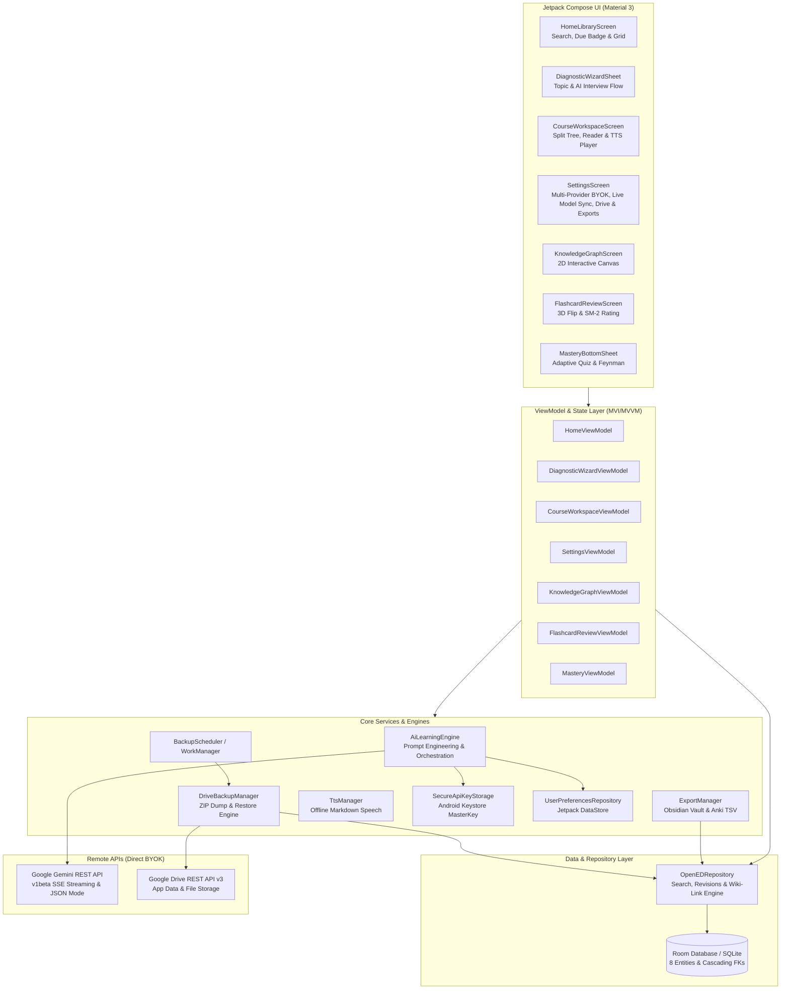
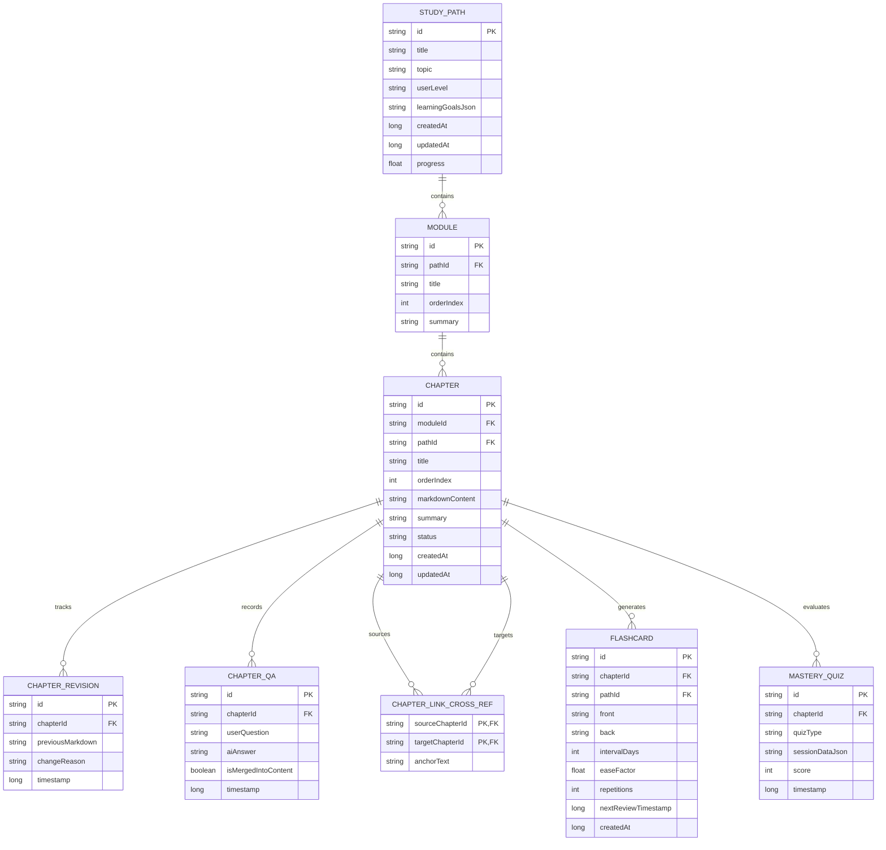

# openED 🧠
> **Personal, Local-First, AI-Powered Self-Learning & Knowledge-Graph Studio**

[](LICENSE)
[](https://kotlinlang.org/)
[](https://developer.android.com/jetpack/compose)
[](https://developer.android.com/training/data-storage/room)
[](https://ai.google.dev/)
[](https://developers.google.com/drive)

**openED** is a production-grade, open-source native Android application designed to transform any topic—from eBPF kernel programming to nutritional biochemistry—into an adaptive, interconnected self-study curriculum powered by multiple AI providers (Google Gemini, Anthropic Claude, OpenAI GPT, or Custom/Local Ollama BYOK) and synchronized privately to Google Drive.

---

## 🌟 Key Features & AI Workflows

### 1. 🎯 Diagnostic & Personalization Interviewer (Pre-Path Generation)
- **Structured AI Profiling:** Enter any learning subject or topic to trigger a 3–5 question diagnostic interview generated via Gemini Structured JSON Output (`responseMimeType: "application/json"`).
- **Adaptive Questioning:** Evaluates prior knowledge baseline, target depth (introductory, intermediate, mastery), learning goals, and practical vs. theoretical orientation.
- **Interactive Chip UI:** Multi-select chips and custom free-text input allow fluid personalization before syllabus construction.

### 2. 📚 Dynamic Curriculum & Syllabus Synthesis
- **Structured Knowledge Hierarchy:** Synthesizes complete courses broken into chronological Modules and ordered Chapters, equipped with estimated study times, prerequisite chains, and core concept summaries.
- **Instant Local Persistence:** Automatically transactions the entire course hierarchy into Room SQLite, enabling immediate offline access and tracking.
- **Real-Time Progress Tracking:** Reactive calculation of overall course progress as chapters are completed.

### 3. ⚡ On-the-Spot Lesson Streaming & Wiki-Linking
- **Server-Sent Events (SSE) Streaming:** Streams rich Markdown lessons from Gemini (`streamGenerateContent?alt=sse`) in real time with smooth token emission.
- **Automated Cross-Reference Detection:** Scans generated text for references to other chapters across your entire library, automatically converting them into clickable `[[Chapter Title]]` wiki-links.
- **Bi-Directional Knowledge Graph:** Persists link edges in the `ChapterLinkCrossRef` table and renders both **Outgoing Links** and **Backlinks** at the bottom of every chapter reader screen.
- **Dynamic Tangent Branching:** Highlight any concept in the reader to generate a dedicated tangent sub-chapter on the fly.

### 4. ✍️ Contextual Refinement & Socratic Assistant
- **Floating/Bottom Action Bar:** Select any text passage or entire section to trigger contextual AI modifications:
  - **Simplify:** Clarify dense language without sacrificing technical accuracy.
  - **Add Code / Math Example:** Embed concrete syntax-highlighted code or LaTeX formulas.
  - **Fact-Check & Correct:** Verify assertions and correct discrepancies.
  - **Custom Mutation Prompt:** Provide any custom prompt to adapt the text in place.
- **Full Version Control:** Every mutation archives a snapshot to `ChapterRevisionEntity`, enabling complete rollback and revision auditing.
- **Socratic Q&A Assistant:** Ask follow-up questions anchored to the active chapter; tap a single button to append the explanation as a GitHub-style callout block (`> [!NOTE]`) directly into the lesson content.

### 5. 📊 True 2D Math, Diagrams & Benchmark Charts
- **True 2D Mathematical Rendering:** Renders 2D Matrix Grids (`\begin{bmatrix}`, `\begin{pmatrix}`) with bracket borders, stacked fractions with center dividers, summations/integrals (`∑`, `∏`, `∫`) with upper/lower limits, and radical square roots.
- **Unicode Sets & Accented Vectors:** Converts `\mathbb{R,N,Z,Q,C}` to Unicode (`ℝ`, `ℕ`, `ℤ`, `ℚ`, `ℂ`), `\hat{i}, \hat{j}, \vec{v}` to accented characters (`î`, `ĵ`, `v⃗`), and inline matrices to vector transpose notation (`[a, b]ᵀ`).
- **Interactive Visual Architecture Diagrams:** Parses ` ```diagram ` / ` ```mermaid ` into pan/zoomable Compose Canvas node-and-arrow diagrams with rounded cards and directional arrowheads.
- **2D Coordinate & Benchmark Plots:** Parses ` ```chart ` / ` ```plot ` into 2D Cartesian vector plots and performance benchmark comparison bars.
- **Material 3 Markdown Tables:** Styled table cards with alternating row colors and horizontal scrolling.
- **Code Syntax Highlighting:** Dark card presentation with language tags, horizontal scrolling, and one-tap copy-to-clipboard functionality.
- **GitHub-Style Alerts:** Native rendering for callout alerts: `[!NOTE]`, `[!TIP]`, `[!IMPORTANT]`, `[!WARNING]`, and `[!CAUTION]`.

### 6. 🔍 Offline Instant Full-Text Search
- Instantaneous search across all study paths, modules, chapters, revision histories, and Socratic Q&A threads.
- Direct jump from search results into the exact chapter and highlighted context.

### 7. 🔒 Multi-Provider BYOK & Keystore Security
- **Multi-Provider AI Router:** Native support for 4 AI engines:
  1. **Google Gemini** (`gemini-3.8-flash`, `gemini-3.6-flash`, `gemini-3.5-flash-lite`, `gemini-3.1-pro-preview`)
  2. **Anthropic Claude** (`claude-sonnet-4-6`, `claude-opus-4-6`, `claude-haiku-4-5`)
  3. **OpenAI GPT** (`gpt-4.1`, `gpt-4o`, `o3-mini`)
  4. **Custom (OpenAI-Compatible):** Base URL, API Key, and Model Name (local Ollama, LM Studio, vLLM, DeepSeek, Groq).
- **Android Keystore Encryption:** API keys are encrypted at rest with AES-256 GCM using `EncryptedSharedPreferences` backed by the Android Keystore Master Key (`opened_secure_vault`).
- **Unified Streaming Client:** Direct SSE streaming (`alt=sse`, Anthropic events, OpenAI delta chunks) and structured JSON outputs across all providers.

### 8. ☁️ Google Drive Backup & Synchronization
- **Portable ZIP Export Bundle:** Serializes the full Room database into a clean JSON bundle packaged in `opened_backup_v1.zip` (excluding private API keys).
- **Background Sync via WorkManager:** Scheduled periodic backups and on-demand manual sync using Jetpack `WorkManager`.
- **Conflict Resolution Engine:** Choose between **Merge Local** (preserves local edits and additions) and **Overwrite Local** (replaces local database with remote snapshot).

### 9. 🧠 Spaced Repetition Flashcards (SuperMemo SM-2 / FSRS)
- **AI Card Synthesis:** Extract 5–10 high-yield active recall flashcards from any chapter using Structured JSON output.
- **SM-2 Scheduling:** Local calculation of repetition counts, ease factor adjustments, and exponential interval progression (`FlashcardEntity`).
- **In-Chapter Flashcard Deck:** Dedicated badge on the top-bar and bottom-bar `"Cards (N)"` button in `CourseWorkspaceScreen` that opens an interactive 3D flip card bottom sheet with rating buttons (*Again*, *Hard*, *Good*, *Easy*).
- **Home Review Due Banner:** Prominent banner on the Home Screen indicating how many cards are due today, with one-tap jump to the review deck.

### 10. 🎯 Feynman Challenge & Adaptive Mastery Quizzes
- **Scenario-Based Adaptive Quizzes:** 5 generated multiple-choice questions assessing deep comprehension with detailed explanations for every option.
- **Feynman Technique Evaluator:** Explain concepts in your own words; Gemini analyzes your response and provides structured feedback (`score`, `whatYouGotRight`, `missingConcepts`, `refinedExplanation`).
- **Mastery Auditing:** All quiz attempts and Feynman sessions are saved locally to `MasteryQuizEntity`.

### 11. 🕸️ Interactive 2D Knowledge Graph
- **Force-Directed Physics Simulation:** Visualizes all course chapters and their bi-directional wiki-link connections on a 2D Canvas with gesture-based pan and pinch-to-zoom (`detectTransformGestures`).
- **Color-Coded Mastery Status:** Completed, generating, and pending nodes rendered dynamically. Tapping any node navigates straight to that lesson.

### 12. 🎧 Commute Audio Mode (Offline TTS Reader)
- **Embedded Text-to-Speech:** Integrated Android `TextToSpeech` with speed toggles (1.0x, 1.5x, 2.0x) and floating mini-player bar.
- **Smart Markdown Normalization:** Automatically strips headers, markdown punctuation, raw code blocks, and LaTeX math formatting before vocalization for an uninterrupted listening experience.

### 13. 📦 Obsidian Vault & Anki Exports
- **Obsidian Vault Export (.zip):** Exports all courses as nested folders containing `.md` files formatted with standard YAML frontmatter and `[[WikiLinks]]`.
- **Anki Deck Export (.tsv):** Exports all generated flashcards into a clean tab-separated format ready for immediate import into Anki.

---

## 🏗️ Architecture & Component Design

openED is built following modern Android Architecture guidelines with reactive Unidirectional Data Flow (MVI/MVVM), Jetpack Compose (Material 3), Hilt Dependency Injection, Room SQLite with `@Transaction` relations, and Coroutine Flows.



---

## 🗄️ Database Schema (Room SQLite)

openED models learning paths, modular lesson hierarchies, revision logs, knowledge graph cross-links, spaced repetition flashcards, and mastery quizzes through 8 normalized Room entities with cascading deletes:



---

## 🚀 Setup & Getting Started

### 1. Prerequisites
- **Android Studio**: Ladybug / Meerkat (or newer)
- **JDK**: Java 21 OpenJDK
- **Android SDK**: Compile SDK 35, Min SDK 26

### 2. Gemini API Key (Bring Your Own Key)
1. Generate an API Key from [Google AI Studio](https://aistudio.google.com/).
2. Open **openED** on your device or emulator.
3. Open **Settings** from the top app bar.
4. Input your Gemini API key and tap **Save Key Securely**.
5. Select your default model (defaulting to `gemini-3.8-flash`).

### 3. Google Drive Cloud Sync Configuration
1. Navigate to the [Google Cloud Console](https://console.cloud.google.com/).
2. Create or select your Google Cloud project.
3. Enable the **Google Drive API** in APIs & Services.
4. Set up an OAuth Consent Screen (External / Internal) and add the `https://www.googleapis.com/auth/drive.file` scope.
5. Create an Android OAuth 2.0 Client ID:
   - **Package Name:** `org.opened.app`
   - **SHA-1 Fingerprint:** Run `./gradlew signingReport` and copy the SHA-1 of your signing key.
6. In openED, go to **Settings > Google Drive Backup** to sign in and initiate sync.

---

## 🛠️ Verification & Build Commands

```bash
# Check Kotlin syntax and compile
./gradlew compileDebugKotlin

# Run all unit tests
./gradlew test

# Assemble debug APK
./gradlew assembleDebug
```

The compiled debug APK will be generated at:
`app/build/outputs/apk/debug/app-debug.apk`

---

## 📄 License

Licensed under the [Apache License, Version 2.0](LICENSE).  
Copyright © 2026 openED Contributors.
