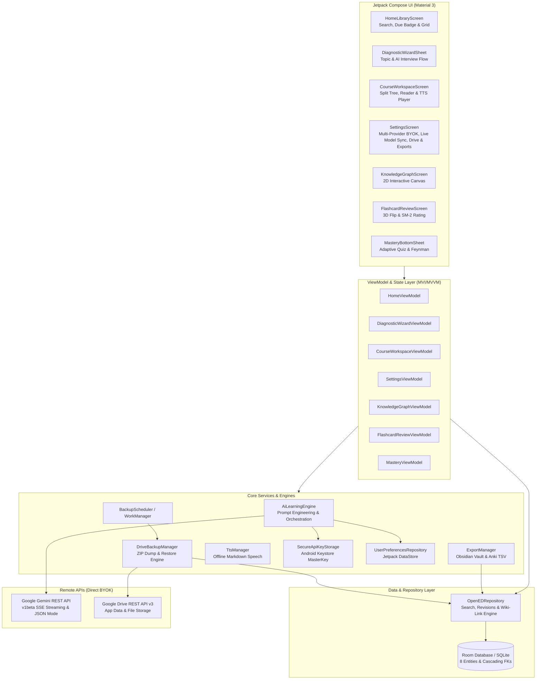
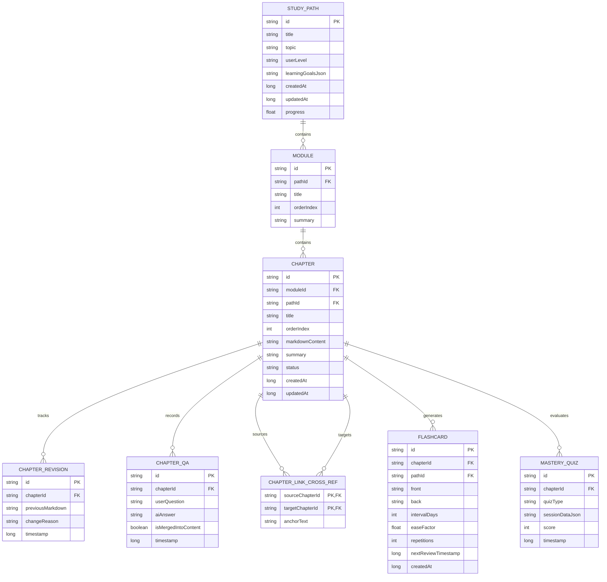

# openED 🧠
> **Personal, Local-First, AI-Powered Self-Learning & Knowledge-Graph Studio**

[](LICENSE)
[](https://github.com/pprpprppr/openED/releases/tag/v1.3.0)
[](https://kotlinlang.org/)
[-3DDC84.svg)](https://developer.android.com/about/versions/16)
[](https://developer.android.com/jetpack/compose)
[](https://developer.android.com/training/data-storage/room)
[](https://ai.google.dev/)
[](https://developers.google.com/drive)

**openED** is a production-grade, open-source native Android application designed to transform any topic—from eBPF kernel programming to nutritional biochemistry—into an adaptive, interconnected self-study curriculum powered by multiple AI providers (Google Gemini, Anthropic Claude, OpenAI GPT, or Custom/Local Ollama BYOK) and synchronized privately to Google Drive.

---

## 🌟 Key Features & AI Workflows

### 1. 🎯 Diagnostic & Personalization Interviewer (Pre-Path Generation)
- **Structured AI Profiling:** Enter any learning subject or topic to trigger a 3–5 question diagnostic interview generated via Gemini Structured JSON Output (`responseMimeType: "application/json"`).
- **Adaptive Questioning:** Evaluates prior knowledge baseline, target depth (introductory, intermediate, mastery), learning goals, and practical vs. theoretical orientation.
- **Interactive Chip UI:** Multi-select chips and custom free-text input allow fluid personalization before syllabus construction.

### 2. 📚 Dynamic Curriculum & Syllabus Synthesis
- **Structured Knowledge Hierarchy:** Synthesizes complete courses broken into chronological Modules and ordered Chapters, equipped with estimated study times, prerequisite chains, and core concept summaries.
- **Instant Local Persistence:** Automatically transactions the entire course hierarchy into Room SQLite, enabling immediate offline access and tracking.
- **Real-Time Progress Tracking:** Reactive calculation of overall course progress as chapters are completed.

### 3. ⚡ On-the-Spot Lesson Streaming & Wiki-Linking
- **Server-Sent Events (SSE) Streaming:** Streams rich Markdown lessons in real time across any configured provider (`alt=sse`, Anthropic events, OpenAI chunks) with smooth token emission.
- **ANR-Proof Streaming Pipeline:** UI updates are throttled to 350ms in `CourseWorkspaceViewModel`, network streams are bound to `Dispatchers.IO`, and heavy Markdown AST parsing is dispatched asynchronously on `Dispatchers.Default` via `produceState`, preventing Main Thread jank and ANR ("Application Not Responding") dialogs.
- **Automated Cross-Reference Detection:** Scans generated text for references to other chapters across your entire library, automatically converting them into clickable `[[Chapter Title]]` wiki-links.
- **Bi-Directional Knowledge Graph:** Persists link edges in the `ChapterLinkCrossRef` table and renders both **Outgoing Links** and **Backlinks** at the bottom of every chapter reader screen.
- **Dynamic Tangent Branching:** Highlight any concept in the reader to generate a dedicated tangent sub-chapter on the fly.

### 4. ✍️ Contextual Refinement & Socratic Assistant
- **Floating/Bottom Action Bar:** Select any text passage or entire section to trigger contextual AI modifications:
  - **Simplify:** Clarify dense language without sacrificing technical accuracy.
  - **Add Code / Math Example:** Embed concrete syntax-highlighted code or LaTeX formulas.
  - **Fact-Check & Correct:** Verify assertions and correct discrepancies.
  - **Custom Mutation Prompt:** Provide any custom prompt to adapt the text in place.
- **Full Version Control:** Every mutation archives a snapshot to `ChapterRevisionEntity`, enabling complete rollback and revision auditing.
- **Socratic Q&A Assistant:** Ask follow-up questions anchored to the active chapter; tap a single button to append the explanation as a GitHub-style callout block (`> [!NOTE]`) directly into the lesson content.

### 5. 📊 True 2D Math, Chemistry, Diagrams & Benchmark Charts
- **True 2D Mathematical Rendering:** Renders 2D Matrix Grids (`\begin{bmatrix}`, `\begin{pmatrix}`) with bracket borders, stacked fractions with center dividers, summations/integrals (`∑`, `∏`, `∫`) with upper/lower limits, and radical square roots.
- **Chemistry & Advanced Symbols:** Full Unicode mapping for chemical reaction arrows (`\longrightarrow` $\rightarrow$ $\longrightarrow$, `\rightleftharpoons`), radical intermediates (`NO^\bullet` $\rightarrow$ $\text{NO}^\bullet$), inline formulas (`$BH_4$` $\rightarrow$ $\text{BH}_4$), and highlighted boxes (`\boxed{A}`).
- **Infinite-Loop Guarded Parsers:** `LatexParser` and `WikiLinkHandler` feature pre-compiled regex caches, 25-iteration maximum bounds, and identity break guards.
- **Unicode Sets & Accented Vectors:** Converts `\mathbb{R,N,Z,Q,C}` to Unicode (`ℝ`, `ℕ`, `ℤ`, `ℚ`, `ℂ`), `\hat{i}, \hat{j}, \vec{v}` to accented characters (`î`, `ĵ`, `v⃗`), and inline matrices to vector transpose notation (`[a, b]ᵀ`).
- **Interactive Visual Architecture Diagrams:** Parses ` ```diagram ` / ` ```mermaid ` into pan/zoomable Compose Canvas node-and-arrow diagrams with rounded cards and directional arrowheads.
- **2D Coordinate & Benchmark Plots:** Parses ` ```chart ` / ` ```plot ` into 2D Cartesian vector plots and performance benchmark comparison bars.
- **Material 3 Markdown Tables:** Styled table cards with alternating row colors and horizontal scrolling.
- **Unclipped Code Syntax Highlighting:** Dark card presentation with language tags, horizontal scrolling that never clips indentation, and one-tap copy-to-clipboard functionality.
- **GitHub-Style Alerts:** Native rendering for callout alerts: `[!NOTE]`, `[!TIP]`, `[!IMPORTANT]`, `[!WARNING]`, and `[!CAUTION]`.

### 6. 🔍 Offline Instant Full-Text Search
- Instantaneous search across all study paths, modules, chapters, revision histories, and Socratic Q&A threads.
- Direct jump from search results into the exact chapter and highlighted context.

### 7. 🔒 Multi-Provider BYOK, Live Model Sync & Keystore Security
- **Multi-Provider AI Router:** Native Bring-Your-Own-Key (BYOK) architecture supporting 5 AI pathways:
  1. **Google Gemini (Default):** Flagship `gemini-3.8-flash`, everyday `gemini-3.6-flash`, ultra-lightweight `gemini-3.5-flash-lite`, and deep-reasoning STEM `gemini-3.1-pro-preview`.
  2. **OpenRouter:** Full model catalog access with real-time live model search, scrollable selector, and automatic HTTPS scheme normalization.
  3. **Anthropic Claude:** `claude-sonnet-4-6`, `claude-opus-4-6`, and `claude-haiku-4-5`.
  4. **OpenAI GPT:** `gpt-4.1`, `gpt-4o`, and `o3-mini`.
  5. **Custom / Local (OpenAI-Compatible):** Connect directly to local Ollama, LM Studio, vLLM, DeepSeek, or Groq with custom base URL, API key, and model ID.
- **Dynamic AI Status Indication:** Context-aware status messaging displaying the active provider and model (e.g., *"Claude is writing module...", "OpenRouter is generating...", "Gemini is synthesizing..."*).
- **Bulletproof JSON Parser & Self-Repair Engine:**
  - Tolerant parser configuring `ignoreUnknownKeys`, `isLenient`, `allowTrailingComma`, and `coerceInputValues`.
  - Self-healing regex repairer that resolves EOF truncated JSON, strips trailing commas, fixes unescaped newlines in markdown payloads, and provides graceful fallbacks so course generation never gets stuck.
- **Human-Friendly Actionable Diagnostics:** Replaces raw HTTP codes with clear, readable error messages and remediation tips for quota limits, network timeouts, authentication issues, and invalid models.
- **Android Keystore Hardware Encryption:** API keys are encrypted at rest with AES-256 GCM using `EncryptedSharedPreferences` backed by the Android Keystore Master Key (`opened_secure_vault`). Zero API key exfiltration guarantee.
- **Unified Streaming Client:** Background-threaded SSE streaming (`alt=sse`, Anthropic events, OpenAI delta chunks) and structured JSON outputs across all providers.

### 8. ☁️ Google Drive & SAF Folder Synchronization
- **Persistent Storage Access Framework (SAF) Sync:** Select any local folder or Google Drive synced directory with persistent Android URI permissions (`FLAG_GRANT_READ/WRITE_URI_PERMISSION`) surviving device reboots.
- **Google Drive API v3 Backup:** Direct cloud synchronization using OAuth 2.0 app data folder backup.
- **Portable ZIP Export Bundle:** Serializes the complete Room database into `opened_backup_v1.zip` (strictly stripping sensitive API keys).
- **Background Sync via WorkManager:** Scheduled periodic backups and on-demand manual sync.
- **Conflict Resolution Engine:** Choose between **Merge Local** (preserves local additions) and **Overwrite Local** (restores snapshot).

### 9. 🧠 Spaced Repetition Flashcards (SuperMemo SM-2 / FSRS)
- **AI Card Synthesis:** Extract 5–10 high-yield active recall flashcards from any chapter using Structured JSON output.
- **SM-2 Scheduling:** Local calculation of repetition counts, ease factor adjustments, and exponential interval progression (`FlashcardEntity`).
- **In-Chapter Flashcard Deck:** Dedicated badge on the top-bar and bottom-bar `"Cards (N)"` button in `CourseWorkspaceScreen` that opens an interactive 3D flip card bottom sheet with rating buttons (*Again*, *Hard*, *Good*, *Easy*).
- **Home Review Due Banner:** Prominent banner on the Home Screen indicating how many cards are due today, with one-tap jump to the review deck.

### 10. 🎯 Feynman Challenge & Adaptive Mastery Quizzes
- **Scenario-Based Adaptive Quizzes:** 5 generated multiple-choice questions assessing deep comprehension with detailed explanations for every option.
- **Feynman Technique Evaluator:** Explain concepts in your own words; Gemini analyzes your response and provides structured feedback (`score`, `whatYouGotRight`, `missingConcepts`, `refinedExplanation`).
- **Mastery Auditing:** All quiz attempts and Feynman sessions are saved locally to `MasteryQuizEntity`.

### 11. 🕸️ Interactive 2D Knowledge Graph
- **Force-Directed Physics Simulation:** Visualizes all course chapters and their bi-directional wiki-link connections on a 2D Canvas with gesture-based pan and pinch-to-zoom (`detectTransformGestures`).
- **Color-Coded Mastery Status:** Completed, generating, and pending nodes rendered dynamically. Tapping any node navigates straight to that lesson.

### 12. 🎧 Commute Audio Mode (Overhauled Chunked TTS Engine)
- **Android 11–16 (API 36) Package Visibility:** Built-in `<queries>` intent declarations ensure seamless discovery and binding to system TTS services (Google TTS, Samsung TTS, Sherpa-ONNX).
- **Intelligent Markdown Stripper:** Runs on `Dispatchers.Default` before playback:
  - Replaces ```` ```diagram ```` and ```` ```mermaid ```` diagrams with natural spoken cues (*"Diagram omitted."*).
  - Condenses fenced code blocks into concise summaries (*"Code example omitted during audio playback."*), preventing hundreds of punctuation marks from being read aloud.
  - Translates mathematical and scientific notation symbols (`→`, `≥`, `≤`, `≠`, `≈`, `±`, `Δ`, `∑`, `∫`) into natural spoken words.
  - Cleans Markdown headings, bold/italic asterisks, backticks, and wiki-link brackets.
- **Sub-1800 Character Chunking:** Automatically divides lessons into paragraph and sentence chunks under 1,800 characters, completely bypassing Android's 4,000-character silent truncation threshold.
- **Resilient Asynchronous Queueing:** Equipped with a `pendingChunks` queue that automatically begins playback the moment the TTS engine finishes initialization.
- **Floating Audio Control Player:** Sleek mini-player floating in the Course Workspace offering Play/Pause, Stop, chunk counter (*"Paragraph X of Y"*), and instant speed multipliers (**1.0x**, **1.25x**, **1.5x**, **2.0x**).

### 13. 📦 Obsidian Vault & Anki Exports
- **Obsidian Vault Export (.zip):** Exports all courses as nested folders containing `.md` files formatted with standard YAML frontmatter and `[[WikiLinks]]`.
- **Anki Deck Export (.tsv):** Exports all generated flashcards into a clean tab-separated format ready for immediate import into Anki.

### 14. 🎓 Subject Tutor Personas, Custom Instructions & AI Prompt Architect
- **13 Subject Pedagogies:** Tailored pedagogical personas across STEM, Humanities, and Social Sciences:
  - 🧬 **Biology:** Biochemical pathways, molecular biology, genetics, and physiological homeostasis.
  - 📜 **History:** Historiography, primary source scrutiny, causation, and socio-political dynamics.
  - 🏛️ **Politics:** Comparative governance, political theory, constitutional law, and international treaties.
  - 🧪 **Chemistry:** Reaction mechanisms, orbital theory, thermodynamics, and stoichiometry.
  - 🔭 **Physics:** Feynman intuition, first-principles derivations, and conservation laws.
  - 📐 **Mathematics:** Formal proofs, lemmas, and visual geometric intuition.
  - 💻 **Computer Science:** Algorithmic complexity, systems architecture, memory safety, and concurrency.
  - 📈 **Economics:** Micro/macroequilibriums, econometric models, and monetary policy.
  - 🧠 **Psychology:** Cognitive architecture, behavioral research, and neural mechanisms.
  - 🎭 **Philosophy:** Socratic dialogue, epistemology, ethics, and hermeneutics.
  - 🌱 **Adaptive Polymath:** Interdisciplinary balance (default).
  - 🚀 **Beginner Friendly:** Analogy-driven, jargon-free explanations.
  - ⚙️ **Custom System Persona:** Driven exclusively by your personalized system instructions.
- **Dedicated Custom System Instructions:** Decoupled preference storage allows users to set persistent personalized rules, which blend seamlessly with any active subject persona.
- **Interactive Quick Templates (Tap to Toggle):** Instant toggleable `FilterChip` templates (e.g. `✨ 3 Takeaways`, `❓ Self-Test Quiz`, `🔬 Case Studies`, `⚡ Socratic Inquirer`, `📐 Step-by-Step Proofs`, `💡 Analogy-Driven`) with visual checkmarks and instant DataStore auto-persistence in both Settings and the Course Creation Wizard.
- **✨ AI Prompt Architect:** Enter brief, rough notes or exam goals (e.g. *"Preparing for USMLE, emphasize clinical correlations and review questions"*), and AI crafts a polished, high-impact system instruction prompt with live preview and one-tap application.

---

## 🏗️ Architecture & Component Design

openED is built following modern Android Architecture guidelines with reactive Unidirectional Data Flow (MVI/MVVM), Jetpack Compose (Material 3), Hilt Dependency Injection, Room SQLite with `@Transaction` relations, and Coroutine Flows.



---

## 🗄️ Database Schema (Room SQLite)

openED models learning paths, modular lesson hierarchies, revision logs, knowledge graph cross-links, spaced repetition flashcards, and mastery quizzes through 8 normalized Room entities with cascading deletes:



---

## 🚀 Installation & Quick Start

### 📲 Direct APK Download (Recommended for Users)
Get the latest pre-compiled, signed release directly from the releases page:
- 🔗 **[Download openED v1.2.2 APK](https://github.com/pprpprppr/openED/releases/latest)**

---

### 💻 Developer Setup & Building from Source

#### 1. Prerequisites
- **Android Studio**: Ladybug / Meerkat (or newer)
- **JDK**: Java 21 OpenJDK
- **Android SDK**: Target & Compile SDK 36 (Android 16), Min SDK 26

#### 2. Configure Your AI Provider (BYOK)
openED features a zero-telemetry Bring-Your-Own-Key model. Your keys never leave your device except to query the official endpoints.
1. Open **openED** on your device or emulator.
2. Navigate to **Settings** from the top app bar.
3. Choose your provider:
   - **Google Gemini:** Enter your key from [Google AI Studio](https://aistudio.google.com/) and choose `gemini-3.8-flash` or `gemini-3.5-flash-lite`.
   - **OpenRouter:** Paste your [OpenRouter Key](https://openrouter.ai/keys), tap **Fetch Models** to search and select from hundreds of open models.
   - **Anthropic Claude:** Paste your Claude key from [Anthropic Console](https://console.anthropic.com/).
   - **OpenAI GPT:** Paste your OpenAI key from [OpenAI Platform](https://platform.openai.com/).
   - **Custom / Local Ollama:** Set your local endpoint (e.g., `http://10.0.2.2:11434/v1` for Android emulator or your LAN IP) and model name (e.g., `llama3.3`).
4. Tap **Save Key Securely**.

#### 3. Cloud & Local Folder Synchronization
- **Persistent Local / Cloud Drive Folder (SAF):** Go to **Settings > Google Drive Backup > Select Backup Folder**, pick any folder on your device or linked Google Drive directory. Permissions persist permanently across device reboots.
- **Google Drive Cloud v3 API:** Enable Drive API in Google Cloud Console, add `https://www.googleapis.com/auth/drive.file` scope, and register your SHA-1 signature.

---

## 🛠️ Verification & Build Commands

```bash
# Compile and verify Kotlin syntax
./gradlew compileDebugKotlin

# Run all unit tests (including MarkdownStripper, LatexParser & AST benchmarks)
./gradlew testDebugUnitTest

# Assemble production Release APK
./gradlew assembleRelease

# Assemble Debug APK
./gradlew assembleDebug
```

The compiled release APK will be located at:
`app/build/outputs/apk/release/app-release.apk`

---

## 📄 License

Licensed under the [Apache License, Version 2.0](LICENSE).  
Copyright © 2026 openED Contributors.
